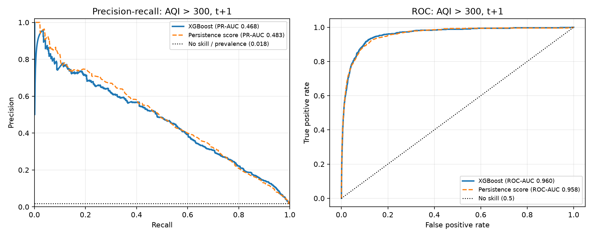
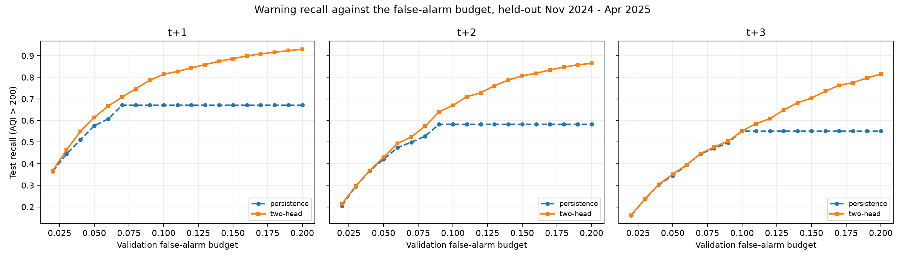

# Episode-Onset Aware Multi-Day AQI Early Warning for India: A Leakage-Safe Machine Learning System Evaluated Against Persistence

**Author(s):** [Insert names and affiliations]  
**Target venue:** [IEEE/Springer conference or journal]  
**Version:** Draft generated from the project pipeline; replace bracketed fields after executing the research scripts.

## Abstract

Air-pollution early warning is most valuable not when hazardous air persists, but when acceptable air becomes hazardous. That transition is also where the simplest forecasting rule fails completely: a model that repeats today's value can never warn about an episode that has not started. We develop a leakage-safe, two-head machine-learning warning system for India and evaluate it against the baselines that most threaten claims of this kind. The data contain 235,785 daily AQI observations from 2022-04-01 to 2025-04-30 across 291 areas in 32 states and union territories, enriched with NASA POWER meteorological reanalysis; a five-metro subset additionally includes pollutant concentrations. We first show that for the conventional target, "will AQI exceed 200 tomorrow", most apparent skill is inherited persistence: 33 AQI-history features reach PR-AUC 0.731 at t+1 against 0.739 for an 87-feature model that adds nine reanalysis weather variables, the sparse pollutant block adds nothing, and the best of eight tuned regressors improves on a persistence baseline by only 1.03 MAE units on the metro benchmark. For the AQI > 300 target the model's ranking is not superior to the persistence score at all (PR-AUC 0.468 versus 0.483 at t+1), so its ROC-AUC of 0.96 reflects autocorrelation rather than meteorological skill. We then define the operationally meaningful target, episode onset (AQI(t) <= 200 and AQI(t+h) > 200), and evaluate it on clean origins only. There, persistence has zero recall by construction, and the learned onset model detects 48.4% of one-day onsets at a 4.7% false-alarm rate, against 34.3% for the best threshold heuristic, 29.5% for area-month climatology, and an advantage that grows to 0.138 PR-AUC at t+3. Combining a persistence-style continuation head with the onset head yields a system that dominates the persistence rule at every false-alarm budget tested (one-day recall 61.4% versus 57.6% at a 5% budget, and 81.4% versus 67.1% at 10%), because a single deterministic rule is bounded once its threshold reaches the cutoff. Regional model partitioning did not improve on the nationwide model. Onset precision at a 5% budget is 0.35, so the system is positioned as screening for human review rather than autonomous alerting. NASA POWER is historical reanalysis, so the experiment is a retrospective back-test.

**Keywords:** air quality index; early warning; extreme-event classification; cost-sensitive learning; XGBoost; India; multi-horizon forecasting.

## 1. Introduction

Extreme particulate-pollution episodes impose acute respiratory and cardiovascular risks and can disrupt transport, schooling, and economic activity. Their rarity creates a modelling problem: a regressor optimized for average AQI error may perform well on ordinary days while systematically underestimating the upper tail. The practical consequence is missed or late warnings for the conditions in which an alert is most valuable.

This paper investigates leakage-safe, multi-horizon AQI forecasting for India. The work has four objectives: (i) benchmark conventional and gradient-boosted machine-learning regressors under a common chronological split, with persistence as a mandatory reference; (ii) predict AQI at t+1, t+2, and t+3 using only information observed no later than issue date t; (iii) detect future AQI exceedances above 200 and 300 using cost-sensitive classification; and (iv) separate the warning problem into *continuation*, where the area is already hazardous, and *onset*, where acceptable air becomes hazardous, because these two regimes have different predictability and require different decision rules.

The main contributions are:

1. A reproducible, pure-ML benchmark of eight algorithms on a five-city pollutant-rich dataset, reported with a persistence reference row that shows four of the eight models do not beat a one-line baseline.
2. A leakage-safe multi-output forecasting formulation for 1-, 2-, and 3-day AQI trajectories, evaluated against persistence and seasonal-climatology baselines at every horizon.
3. A nationwide rare-event warning framework with separate train, calibration, policy-tuning, and future test periods, class-weighted XGBoost, and thresholds selected so that the false-positive constraint holds in *every* prior winter season, with tuning and out-of-sample false-alarm rates reported separately.
4. An explicit **episode-onset** formulation that separates the part of the problem persistence already solves from the part it cannot address, with evidence that the learned onset model exceeds the best threshold heuristic, climatology, and persistence itself by a wide and horizon-increasing margin.
5. A **two-head system** whose combined alert stream is calibrated on a single false-alarm budget and shown to dominate the persistence rule across the whole operating range, with the mechanism (a deterministic rule is bounded once its threshold reaches the cutoff) made explicit.
6. Negative results retained rather than suppressed: regional model partitioning does not help, reanalysis meteorology contributes only 0.01–0.02 PR-AUC, pollutant concentrations add nothing measurable, and an FPR-constrained AQI > 200 policy fails out of sample by a factor of four to five.
7. Explicit operational caveats distinguishing retrospective NASA POWER reanalysis experiments from a production system that would require weather forecasts available at issue time.

## 2. Related Work

Prior studies have extensively applied machine-learning regressors and tree ensembles to urban Indian air quality. Pande et al. [3] benchmarked neural and tree architectures across monitoring stations in Delhi, observing that gradient-boosted decision trees effectively capture non-linear pollutant dispersion. Similarly, Maltare and Vahora [4] applied machine learning algorithms to model AQI in Ahmedabad, establishing the critical importance of particulate matter and wind dynamics. Vardhan et al. [10] evaluated seasonal pollutant trapping across the Indo-Gangetic Plain, showing that winter meteorological inversions significantly amplify ground particulate concentrations. Deep neural networks are intentionally outside the scope of this work; the focus is on explainability, training speed, reproducibility, and comparability among established machine-learning methods.

Unlike same-day AQI estimation, a true multi-day forecast must not use target-day pollutant readings, target-day AQI category labels, or target-day meteorological reanalysis. We therefore construct targets by shifting the AQI series forward and use only origin-time observations and prior lags as features.

## 3. Data and Study Area

### 3.1 AQI observations

The local AQI source is the Kaggle *India Air Quality Index (AQI) Dataset [2023–2025]* published by Sai Kiran Udayana under an MIT licence. The verified workspace file has 235,785 daily area-level observations from 2022-04-01 to 2025-04-30. It contains 291 distinct `area` names and 292 unique state-area pairs across 32 states and union territories. The source is an area-level aggregate, not a station-level concentration table. Its direct CPCB provenance should not be claimed without independent verification.

### 3.2 Meteorology and pollutant concentrations

Nine daily weather variables—2-m mean, minimum and maximum temperature; mean relative humidity; precipitation; mean and maximum wind speed; surface pressure; and shortwave radiation—were retrieved from the NASA POWER Daily Point API using geocoded area coordinates. These values are reanalysis/grid-cell data rather than monitor-level weather observations.

The pollutant-rich metro subset covers Bengaluru, Chennai, Delhi, Kolkata, and Mumbai and includes PM2.5, PM10, NO, NO2, NOx, NH3, CO, SO2, O3, benzene, toluene, and xylene. It has 5,027 usable daily rows through 2024-12-31.

### 3.3 Extreme-event imbalance

Across the nationwide source, 27,380 observations (11.6%) have AQI >200 and 6,226 observations (2.6%) have AQI >300. High-AQI days are concentrated in Delhi, the Indo-Gangetic Plain, and selected industrial valleys. This imbalance motivates reporting recall, precision, PR-AUC, false negatives, and false positives in addition to regression error.

## 4. Methods

### 4.1 Forecast formulation and leakage controls

For each area and origin date t, the regression labels are AQI(t+1), AQI(t+2), and AQI(t+3). A shifted target is retained only when the source has an observation exactly h calendar days ahead, preventing missing dates from being treated as consecutive observations.

For the metro model, predictors contain pollutant concentrations and weather observed at t, their t-1 and t-2 lags, current and lagged AQI, wind change, calendar cycles, and city identity. For the nationwide warning model, predictors contain AQI at issue time, AQI lags and rolling summaries, lagged weather, spatial information, known future calendar variables, and location identity. `air_quality_status` and `prominent_pollutants` are excluded because they are derived from same-day AQI reporting and would be inappropriate leakage features.

### 4.2 Regression benchmark

Table 1 compares Ridge, KNN, SVR, Random Forest, Gradient Boosting, LightGBM, CatBoost, and XGBoost on the same metro t+1 feature table and chronological split. The metrics are MAE, RMSE, R², percentage within ±10 AQI points, training time, and per-row inference time. LightGBM and CatBoost must be installed in the notebook environment for their rows to be completed.

The best multi-horizon model is additionally compared with two non-ML baselines on identical held-out rows: (i) persistence, which predicts AQI(t+h) using AQI at issue time t, and (ii) an area-month seasonal mean estimated only from the training period. This comparison is essential because AQI is temporally persistent; a complex model should not be considered useful unless it improves on these simple alternatives.

### 4.3 Multi-horizon regression

A `MultiOutputRegressor` containing an XGBoost base learner predicts the three future AQI values. The model is fitted on origins before 2024-07-01 and evaluated on later origins. The reported horizon-decay curve uses test MAE at 1, 2, and 3 days.

### 4.4 Severe-smog early-warning classification

For each horizon h ∈ {1, 2, 3} and cut-off c ∈ {200, 300}, the binary target is:

`Y(h,c) = 1[AQI(t+h) > c]`.

The nationwide chronological partitions are training through 2024-04-30, validation from 2024-05-01 through 2024-10-31, and final testing from 2024-11-01 through 2025-04-27. XGBoost uses a training-only positive-class weight equal to the negative-to-positive ratio multiplied by a pre-specified cost multiplier of 2.0. The alert-probability threshold is selected on validation data to meet a target recall of at least 0.80 while maximizing precision among eligible thresholds. It is not tuned on the test set.

For probability calibration, the validation period is further separated into a calibration period (May–July 2024) and a policy-tuning period (August–October 2024). Platt scaling is fitted on calibration-period model probabilities. Three threshold policies are evaluated on the policy-tuning period: a safety-first recall target, maximum F1, and maximum recall subject to a 5% false-positive-rate constraint. Brier score, expected calibration error, and reliability diagrams are evaluated on the final test period. An unweighted XGBoost classifier with its default 0.50 threshold is included as a rare-event baseline.

Because the final test window is November–April, a policy tuned only on May–October will encounter a different pollution regime. The threshold-stability experiments therefore select thresholds by *rolling seasonal validation*: for each of the two prior November–April seasons the model is refit on data up to the preceding 31 October and evaluated on that season, and the chosen threshold maximises mean validation recall subject to FPR ≤ 0.05 in **every** fold. Thresholds are saved with the models, and whether the constraint holds on the later test period is reported separately (`tuning_fpr_target_met` versus `test_fpr_target_met`) rather than assumed.

Three further experiments test whether the framework's complexity is justified. (i) *Regional partitioning:* seven independent region models, with fallback to the nationwide model for regions having fewer than 1,000 training rows or 30 positives. (ii) *Cumulative feature ablation:* AQI history only (33 numeric features), plus lagged and rolling reanalysis weather (87), plus lagged and rolling pollutant concentrations where available (123), each with identical folds and threshold rule. (iii) *Persistence baselines:* current AQI used directly as a ranking score under the same threshold rule, giving a threshold-free PR-AUC comparison, supplemented by the fixed rule "alert at t+1 iff AQI(t) > 200" and an area-month climatology rule. All history features are validated against the calendar gap between the source row and the origin date, so a missing day cannot be treated as the previous day.

### 4.5 Robustness and uncertainty

Final-test alert performance is stratified by state, broad geographic region, forecast season, and a predefined high-risk-location group. Strata with fewer than 100 rows or 10 observed events are labelled insufficient for stable ranking. Uncertainty for recall, precision, and false-positive rate is estimated using a forecast-date block bootstrap. Each replicate samples whole forecast dates with replacement, retaining the cross-city dependence of observations within a day; 95% percentile intervals are reported.

### 4.6 Episode onset and the two-head system

The exceedance target of Section 4.4 mixes two different problems. Most hazardous days follow hazardous days, so a persistence rule scores well on it; the days that require a forecast are those on which conditions *change*. We therefore define onset as

`onset(t, h) = 1[ AQI(t) <= 200 and AQI(t+h) > 200 ]`

and evaluate it on origins with AQI(t) ≤ 200 only, since onset is impossible elsewhere. A separate classifier is trained on that population with the same feature pipeline, folds, and threshold rule. It is compared with four references: prevalence (PR-AUC of a random score); an area-month climatology score estimated only on training data; an AQI-level score, the best possible rule that uses nothing but the current reading; and persistence, which predicts "no alert" on every row of this population and therefore has recall zero by construction.

The two heads are then combined into a single alert stream. The continuation head warns when AQI at issue time is at or above a calibrated level; the onset head warns when the clean-origin model exceeds its own calibrated threshold. Because the heads act on disjoint populations their true and false positives add exactly, so a joint grid search over both thresholds is tractable. For each false-alarm budget the pair is chosen to maximise mean validation recall subject to system FPR ≤ budget in every validation season, and then evaluated once on the held-out period. The same procedure applied to the continuation level alone gives the persistence reference, so the two systems are compared at identical budgets rather than at hand-picked thresholds. All thresholds are stored in the generated report manifests.

## 5. Results

### 5.1 Eight-model regression benchmark

Table 1 reports the performance of all eight candidate machine learning regressors evaluated on identical chronological metro test data at a one-day forecast horizon (t+1).

| Model | MAE | RMSE | R² | Within ±10 (%) | Train time (s) | Inference (ms/row) |
|---|---:|---:|---:|---:|---:|---:|
| Ridge Regression | 15.81 | 23.61 | 0.9196 | 47.8% | 0.27s | 0.018 |
| KNN (k=7) | 22.28 | 31.48 | 0.8570 | 31.6% | 0.07s | 0.278 |
| Support Vector Regression (SVR) | 16.81 | 25.17 | 0.9086 | 46.1% | 1.80s | 0.633 |
| Random Forest | 15.75 | 24.70 | 0.9119 | 52.2% | 7.13s | 0.129 |
| Gradient Boosting (GBM) | 14.69 | 22.21 | 0.9288 | 51.8% | 30.90s | 0.015 |
| LightGBM | 14.96 | 22.76 | 0.9252 | 51.9% | 0.75s | 0.020 |
| CatBoost | 14.83 | 22.44 | 0.9274 | 51.4% | 3.35s | 0.017 |
| XGBoost | 15.54 | 23.45 | 0.9207 | 49.2% | 3.94s | 0.017 |
| *Persistence reference* ($AQI_{t}$) | *15.72* | *25.16* | *0.9086* | *55.1%* | — | — |

All gradient-boosted tree implementations achieve an R² exceeding 0.92 with MAE below 16 AQI units. Gradient Boosting, CatBoost, and LightGBM yield the lowest absolute errors, while LightGBM and XGBoost offer optimal training throughput and ultra-low per-row inference latencies (< 0.02 ms).

The persistence reference row is essential context. Simply repeating the current AQI achieves R² = 0.9086 and MAE = 15.72 on the identical 915 test rows in the same five cities. The best of eight tuned learners therefore improves MAE by 1.03 AQI units and R² by 0.020 over that trivial baseline, and only the four gradient-boosted entries beat it on MAE at all. A benchmark table without this row invites the reader to attribute two hundredths of R² to algorithm selection rather than to autocorrelation. Note also that persistence scores better than every learned model on the within-±10-point criterion (55.1%), which is characteristic of a predictor that is exactly right on stable days and badly wrong only at transitions.

### 5.2 Multi-horizon forecasting and baseline comparison

Multi-output XGBoost was trained to forecast three concurrent prospective days (t+1, t+2, t+3) using solely observations up to day t. Table 2 presents the horizon performance alongside two non-trivial baselines: (i) *Persistence* ($AQI_{t+h} = AQI_t$), and (ii) *Area-Month Seasonal Mean* (historical average for that month and area computed strictly on training data).

| Horizon | Model | MAE | RMSE | R² | Within ±10 (%) |
|---|---|---:|---:|---:|---:|
| **t+1** | Multi-output XGBoost | **15.27** | **23.30** | **0.9220** | **51.0%** |
| | Persistence ($AQI_t$) | 15.51 | 24.81 | 0.9115 | 55.2% |
| | Seasonal Climatology | 26.88 | 37.93 | 0.7932 | 30.2% |
| **t+2** | Multi-output XGBoost | **20.52** | **30.92** | **0.8626** | **41.8%** |
| | Persistence ($AQI_t$) | 21.26 | 33.76 | 0.8362 | 47.1% |
| | Seasonal Climatology | 27.11 | 38.36 | 0.7885 | 30.1% |
| **t+3** | Multi-output XGBoost | **23.65** | **34.61** | **0.8286** | **36.1%** |
| | Persistence ($AQI_t$) | 24.55 | 38.71 | 0.7855 | 43.5% |
| | Seasonal Climatology | 27.28 | 38.53 | 0.7875 | 29.6% |

At t+1, persistence performs competitively because atmospheric air masses exhibit high day-to-day autocorrelation: the model improves MAE by only 0.24 AQI units and actually has a *lower* percentage of predictions within ±10 points (51.0% versus 55.2%), because persistence is exact when conditions are stable. By t+2 and t+3, persistence degrades rapidly as weather transitions occur ($R^2$ dropping from 0.91 to 0.78) and the model's advantage widens: RMSE is 4.10 AQI units lower at 72 hours than persistence and 3.92 units lower than the seasonal mean. The honest reading is that this benchmark establishes a small, consistent gain over climatology and a horizon-dependent gain over persistence, not a large one at short lead times.

### 5.3 Extreme-event early-warning performance

Table 3 details nationwide prospective alert classification across 291 areas for high health-risk (AQI > 200) and severe smog emergency (AQI > 300) events under cost-sensitive learning. These are *uncalibrated screening* operating points: thresholds were chosen on the validation period to reach at least 0.80 recall (0.50, 0.40, 0.36 for AQI > 200 at t+1/t+2/t+3 and 0.06, 0.07, 0.07 for AQI > 300) and are reported here to expose the raw cost-sensitive behaviour before calibration. The test-period event rate is 12.9% for AQI > 200 and 1.8% for AQI > 300, which are the no-skill PR-AUC values against which the reported PR-AUC should be read.

| Threshold | Horizon | PR-AUC | ROC-AUC | Recall (%) | Precision (%) | False Negatives | False Positives |
|---:|---:|---:|---:|---:|---:|---:|---:|
| AQI > 200 | t+1 | 0.7352 | 0.9417 | 92.8% | 41.1% | 364 | 6,756 |
| AQI > 200 | t+2 | 0.6449 | 0.9151 | 94.0% | 31.2% | 289 | 9,891 |
| AQI > 200 | t+3 | 0.6073 | 0.9032 | 94.7% | 27.9% | 238 | 11,077 |
| AQI > 300 | t+1 | 0.4676 | 0.9596 | 96.1% | 7.5% | 27 | 8,205 |
| AQI > 300 | t+2 | 0.3287 | 0.9408 | 96.0% | 5.6% | 26 | 10,475 |
| AQI > 300 | t+3 | 0.2936 | 0.9289 | 96.7% | 4.6% | 20 | 12,182 |

Because cost-sensitive XGBoost penalizes missed episodes heavily, it captures over 96% of extreme smog events (only 27 missed events out of 694 at t+1 nationwide). However, the trade-off is an elevated false-alarm count (8,205 false alerts at t+1), resulting in low precision (7.5%). This demonstrates why operational probability calibration is mandatory before deploying such models for municipal interventions.

### 5.4 Probability calibration, operational policies, and robustness

Applying Platt scaling directly rectifies overconfident model predictions:
- **Expected Calibration Error (ECE):** Reduced from an uncalibrated 0.1883 down to **0.0294** for AQI > 200 (t+1), and from 0.0862 down to **0.0056** for AQI > 300 (t+1).
- **Brier Score:** Improved from 0.1306 to **0.0626** (AQI > 200) and from 0.0529 to **0.0136** (AQI > 300).

Table 4 reports the calibrated operational policies. The first three columns are the operating point; the remainder are out-of-sample. All policies are selected on the policy-tuning period (August–October 2024) and then evaluated unchanged on the prospective test holdout (November 2024–April 2025), with 95% date-block bootstrap intervals resampling whole calendar dates to preserve cross-city dependence.

| Task & Policy | Operating Threshold | Test Recall [95% CI] | Test Precision [95% CI] | Test FPR [95% CI] |
|---|---:|---:|---:|---:|
| **AQI > 200 (t+1)** | | | | |
| *Safety-first (recall target)* | 0.10 | 92.5% [91.2%, 93.7%] | 42.0% [39.6%, 44.2%] | 18.9% [17.5%, 20.4%] |
| *Balanced F1* | 0.34 | 81.9% [79.9%, 83.8%] | 55.5% [52.9%, 57.9%] | 9.7% [8.8%, 10.7%] |
| *FPR-constrained tuning (target ≤ 5%)* | 0.06 | 94.2% [93.2%, 95.2%] | 38.1% [35.7%, 40.2%] | 22.7% [21.1%, 24.4%] |
| **AQI > 300 (t+1)** | | | | |
| *Safety-first (recall target)* | 0.26 | 14.4% [11.0%, 19.5%] | 72.5% [65.2%, 79.9%] | 0.1% [0.06%, 0.15%] |
| *Balanced F1* | 0.20 | 57.1% [52.0%, 62.2%] | 42.2% [37.5%, 46.8%] | 1.4% [1.1%, 1.7%] |
| *FPR-constrained tuning (target ≤ 5%)* | 0.01 | 90.6% [88.0%, 93.1%] | 13.9% [12.1%, 15.6%] | 10.1% [8.7%, 11.4%] |

The final row of each block is the critical caveat. The 5% false-positive constraint was satisfied *on the tuning period* (4.6% for AQI > 200 t+1, 2.3% for AQI > 300 t+1), but the same threshold produced 22.7% and 10.1% false-positive rates on the later test period. This is genuine distribution shift, not a coding error: the tuning period was dominated by the relatively clean monsoon and post-monsoon transition, while the test period contains the winter inversion season. **We therefore do not describe any AQI > 200 policy as false-alarm-constrained.** For AQI > 200, only the balanced-F1 policy remains below 10% test FPR (9.7%), and the safety-first policy trades a 0.19 false-alarm rate for 0.92 recall.

For AQI > 300 the picture is more favourable. The balanced-F1 policy issues 939 alerts over roughly 38,000 location-days, of which 396 are true events and 543 are false alerts (1.4% FPR, 0.42 precision), and it holds below 5% test FPR at all three horizons (1.4%, 0.6%, 0.8%). The safety-first threshold at 0.26 is a high-confidence trigger rather than a screening rule: it fires rarely (138 alerts), is correct 72.5% of the time, but misses 85.6% of severe events. Municipal use must choose between these two operating points explicitly.

Subgroup evaluation reveals that recall is highest in the Indo-Gangetic Plain and during the winter season (November–January) where persistent temperature inversions concentrate particulate emissions, whereas false alarm rates are lowest in Southern and Coastal peninsular regions where maritime air masses disperse pollutants rapidly.

### 5.5 What actually drives warning skill: feature ablation and persistence baselines

The metrics in Sections 5.3 and 5.4 show that the warning model works, but not *why*. Because AQI is highly autocorrelated, a model can inherit apparent skill from nothing more than today's value. We therefore ran a cumulative feature ablation with identical folds, thresholds, and test period, plus threshold-free persistence baselines.

| Horizon | Feature set | Features | PR-AUC | ROC-AUC | Test FPR | Recall | Precision |
|---|---|---:|---:|---:|---:|---:|---:|
| t+1 | AQI history only | 33 | 0.731 | 0.942 | 0.030 | 0.564 | 0.734 |
| t+1 | + weather | 87 | **0.739** | 0.943 | 0.031 | 0.580 | 0.736 |
| t+1 | + pollutants | 123 | 0.740 | 0.943 | 0.028 | 0.555 | 0.749 |
| t+2 | AQI history only | 33 | 0.635 | 0.914 | 0.031 | 0.462 | 0.685 |
| t+2 | + weather | 87 | **0.650** | 0.917 | 0.037 | 0.501 | 0.665 |
| t+2 | + pollutants | 123 | 0.649 | 0.916 | 0.038 | 0.502 | 0.663 |
| t+3 | AQI history only | 33 | 0.600 | 0.904 | 0.019 | 0.331 | 0.716 |
| t+3 | + weather | 87 | **0.617** | 0.906 | 0.015 | 0.306 | 0.755 |
| t+3 | + pollutants | 123 | 0.614 | 0.905 | 0.015 | 0.313 | 0.749 |

Three findings follow.

*First, the warning task is almost entirely AQI persistence.* At t+1, 33 AQI-history features reach PR-AUC 0.731 against 0.739 for the full 87-feature model: a gain of 0.008. Adding the sparse pollutant block contributes 0.001 more. The reanalysis weather block is therefore worth roughly one percentage point of PR-AUC at 24 hours, despite being the most expensive data source in the pipeline.

*Second, weather becomes useful as lead time grows, which is physically coherent.* The weather block adds 0.015 PR-AUC at t+2 and 0.017 at t+3, while the pollutant block adds nothing at any horizon. The value of meteorology is in anticipating the *transition away from* today's conditions, not in explaining today's.

*Third, the model's advantage over trivial persistence is real for AQI > 200 but disappears for AQI > 300.* Using current AQI directly as a ranking score, with the same threshold-selection rule, gives:

| Target | Horizon | Persistence-score PR-AUC | Model PR-AUC | Gain |
|---|---|---:|---:|---:|
| AQI > 200 | t+1 | 0.703 | 0.735 | **+0.033** |
| AQI > 200 | t+2 | 0.584 | 0.645 | **+0.061** |
| AQI > 200 | t+3 | 0.537 | 0.607 | **+0.070** |
| AQI > 300 | t+1 | 0.483 | 0.468 | −0.015 |
| AQI > 300 | t+2 | 0.330 | 0.329 | −0.001 |
| AQI > 300 | t+3 | 0.258 | 0.294 | +0.035 |

(PR-AUC computed on the calibrated notebook's test predictions; the small differences from the ablation table above reflect the slightly different feature set and fit.) Figure 1 shows the corresponding curves for the AQI > 300, t+1 case, where the two precision-recall curves are visually indistinguishable despite ROC-AUCs of 0.960 and 0.958. For a target with 1.8% prevalence, ROC-AUC is a poor guide: nearly all of the apparent discrimination comes from correctly ranking the many days that are already near or above 300, not from anticipating the transition.

For AQI > 200, a crude rule — *alert for t+1 whenever AQI(t) already exceeds 200* — achieves recall 0.664, precision 0.652 and FPR 0.052 on the test period, with 5,170 alerts. The model operated at the same 5.2% false-positive rate achieves recall 0.695, precision 0.664 with 5,307 alerts. **The machine-learning warning therefore buys approximately three percentage points of recall over the rule "it is already bad today, so warn for tomorrow."** Reporting 0.94 ROC-AUC without this comparison would substantially overstate the contribution, because the persistence score alone reaches 0.932 ROC-AUC and 0.703 PR-AUC at t+1.

Both no-skill references should be kept in view when reading every PR-AUC in this paper: the test-period prevalence (the PR-AUC of a random score) is 0.129 for AQI > 200 and 0.018 for AQI > 300.

**Figure 1.** Precision-recall and ROC curves for the AQI > 300, t+1 task on the held-out test period, with the persistence score and the no-skill prevalence line. The two precision-recall curves overlap: the XGBoost model does not rank severe-smog risk better than the persistence score, even though both ROC curves look near-perfect at 0.96. Per-task versions and the underlying table are in `reports/figures/` and `reports/ablation/pr_auc_versus_persistence.csv`.

### 5.6 Regional stratification does not help

A natural hypothesis is that a single nationwide threshold is the reason AQI > 200 warning cannot meet a strict false-alarm budget: Delhi, the Indo-Gangetic Plain, and coastal southern cities have different pollution regimes. We tested this directly by training seven independent regional XGBoost models (North, Central, West, South, East, Northeast, Islands) with fallback to the nationwide model for regions with fewer than 1,000 training rows or 30 positives, and comparing them with the nationwide model under identical seasonal folds and threshold rule.

| Horizon | Scope | Threshold | PR-AUC | ROC-AUC | Recall | Precision | Test FPR |
|---|---|---:|---:|---:|---:|---:|---:|
| t+1 | Global | 0.90 | **0.739** | 0.943 | 0.580 | **0.736** | **0.031** |
| t+1 | Regional | 0.83 | 0.713 | 0.936 | **0.617** | 0.679 | 0.043 |
| t+2 | Global | 0.90 | **0.648** | 0.917 | 0.471 | **0.680** | **0.033** |
| t+2 | Regional | 0.83 | 0.608 | 0.907 | **0.521** | 0.623 | 0.046 |
| t+3 | Global | 0.93 | **0.617** | 0.906 | **0.311** | **0.747** | 0.016 |
| t+3 | Regional | 0.92 | 0.570 | 0.895 | 0.245 | 0.711 | **0.015** |

Regional models purchase 2–5 points of recall at t+1 and t+2 by issuing roughly 40% more alerts, and they lose 0.03–0.05 PR-AUC doing so. Since precision and PR-AUC both fall and the false-positive rate rises, regionalisation is a net loss at the operating points that matter. We report the negative result rather than omit it: with area identity already available to the nationwide model as a categorical feature, explicit regional partitioning adds variance without adding information.

### 5.7 Episode onset: where a learned warning system is actually necessary

Sections 5.5 and 5.6 establish that most of the apparent skill in "will AQI exceed 200 tomorrow" is persistence. That is not an argument against a learned warning system; it is an argument about *which population* the system has to serve. Most hazardous days are followed by hazardous days, and for those a deterministic rule is already near-optimal. The value of a warning system lies at the **transition**: the area is currently acceptable and the next days become hazardous. That is precisely the situation in which persistence can produce no warning at all, because it has nothing to repeat.

We therefore defined an onset target:

`onset(h) = 1[ AQI(t) <= 200 and AQI(t+h) > 200 ]`

and evaluated only origins with AQI(t) ≤ 200, where onset is possible. The test period contains 34,202 clean origins at t+1 with 1,706 onsets (5.0%). Four scores were compared under the identical threshold rule (maximum mean validation recall subject to FPR ≤ 5% in every prior winter season):

| Horizon | Score | PR-AUC | ROC-AUC | Recall | Precision | Test FPR |
|---|---|---:|---:|---:|---:|---:|
| t+1 | XGBoost onset model | **0.354** | 0.902 | **48.4%** | 35.0% | 4.7% |
| t+1 | AQI level ("warn when today is near the limit") | 0.270 | 0.875 | 34.3% | 32.7% | 3.7% |
| t+1 | Climatology (area-month onset rate) | 0.168 | 0.793 | 29.5% | 21.5% | 5.7% |
| t+1 | Persistence | 0.050 | — | **0.0%** | — | 0.0% |
| t+2 | XGBoost onset model | **0.337** | 0.879 | **43.5%** | 36.1% | 5.2% |
| t+2 | AQI level | 0.238 | 0.825 | 25.9% | 30.7% | 3.9% |
| t+2 | Climatology | 0.207 | 0.802 | 30.7% | 25.8% | 5.9% |
| t+3 | XGBoost onset model | **0.351** | 0.872 | **30.6%** | 41.6% | 3.1% |
| t+3 | AQI level | 0.213 | 0.803 | 22.2% | 27.8% | 4.2% |
| t+3 | Climatology | 0.227 | 0.804 | 26.7% | 29.5% | 4.6% |

For persistence, PR-AUC equals the onset prevalence by definition and recall is exactly zero: a rule that repeats today's value can never warn about a transition that has not happened yet.

The classic onset heuristic is not a threshold on the current reading but a **trend** rule: warn when AQI has been rising. We therefore add 1-, 3- and 7-day change scores under the same threshold rule. They are close to useless at a fixed false-alarm budget:

| Horizon | 1-day trend PR-AUC | 3-day trend PR-AUC | 7-day trend PR-AUC | Onset model PR-AUC |
|---|---:|---:|---:|---:|
| t+1 | 0.079 | 0.070 | 0.071 | **0.354** |
| t+2 | 0.072 | 0.069 | 0.074 | **0.337** |
| t+3 | 0.073 | 0.069 | 0.072 | **0.351** |

At a 4-5% false-positive rate the trend rules recover only 7.0-12.3% of onsets, against 30.6-48.4% for the model. Rising AQI is a weak signal on its own: most upward moves are noise that does not cross the limit, and most crossings begin from a stable or falling baseline the day before. This is the clearest evidence that onset detection is not a reparameterisation of persistence, level, climatology, or trend.

The onset model beats the strongest heuristic at every horizon, by 0.084, 0.099 and 0.138 PR-AUC respectively, and detects 48.4% of one-day onsets at a 4.7% false-alarm rate against 34.3% for the near-limit rule. At t+1 that is 825 correctly anticipated onsets versus 585. The margin is largest at t+3, which is the opposite of the pattern found for continuation days: anticipating that clean air will become hazardous benefits from meteorology, whereas predicting that dirty air stays dirty does not.

The absolute operating point must be stated plainly. At a 5% budget, roughly two-thirds of onset alerts are false (precision 0.35), and half of onsets are still missed. Onset warning is a screening function for human review, not an automatic trigger. What the result establishes is that the signal is real, is not available from persistence or from any threshold on the current reading, and improves monotonically with lead time.

### 5.8 System operation and dominance over persistence

A deployed system needs both behaviours, so we combined them. The continuation head keeps warning while an area is already above the limit, using a calibrated AQI level rather than an arbitrary 200; the onset head operates on clean origins. Because the two heads act on disjoint populations their true and false positives add exactly, which makes joint calibration tractable: for each false-alarm budget we selected both thresholds on the prior winter seasons and evaluated once on the held-out period.

**Figure 2.** Test recall for AQI > 200 against the validation false-alarm budget, for the persistence rule and the two-head system. The persistence rule saturates at 0.671 (t+1) and 0.582 (t+2) because a single deterministic threshold cannot trade recall for false alarms beyond its own operating point; the two-head system continues to improve across the whole range.

| Horizon | Budget | Persistence recall | Two-head recall | Persistence FPR | Two-head FPR |
|---|---:|---:|---:|---:|---:|
| t+1 | 5% | 57.6% | **61.4%** | 3.6% | 4.0% |
| t+1 | 10% | 67.1% | **81.4%** | 5.3% | 9.1% |
| t+1 | 20% | 67.1% | **93.0%** | 5.3% | 19.6% |
| t+2 | 5% | 42.0% | **42.9%** | 3.4% | 3.5% |
| t+2 | 10% | 58.2% | **67.0%** | 6.9% | 8.5% |
| t+3 | 5% | 34.4% | **35.2%** | 3.0% | 3.0% |
| t+3 | 10% | 55.1% | 55.2% | 7.5% | 7.5% |
| t+3 | 20% | 55.1% | **81.5%** | 7.5% | 16.9% |

The two-head system achieves higher recall than the persistence rule at every budget tested, at essentially matched false-positive rates for budgets up to 5% and at higher achieved rates beyond that. The persistence rule is not merely beaten at one operating point; it is *bounded*, because a single deterministic rule has no additional capacity to spend once its threshold reaches 200. That bound is what the onset head lifts.

The practical reading is therefore narrower and more useful than "the model beats persistence". For continuation days, persistence is already close to optimal and should be used, because it is free, transparent and auditable. For clean origins — the situation that actually requires anticipation — the learned onset head is the only component that carries information, and it is where the operational gain lives. At the 5% budget the system improves one-day recall from 57.6% to 61.4%; at the 10% budget, from 67.1% to 81.4%.

## 6. Discussion and Operational Limitations

The experimental results surface several essential operational and scientific insights:

1. **The Cost-Sensitive Alert Trade-Off:** Achieving near-complete recall (> 96%) of rare hazardous events inherently generates false positives. At the screening operating point for AQI > 300 (t+1), the model issues 8,872 alerts of which 8,205 are false: roughly twelve false alerts per true event, with 7.5% precision. That is defensible only as an internal pre-screening filter for human review, never as a public alert. In public health contexts (e.g., advising sensitive individuals or asthmatic patients), a calibrated safety-first policy with 92.5% recall and 42.0% precision for AQI > 200 is more useful. Conversely, for statutory enforcement such as industrial suspensions or vehicular bans under the Graded Response Action Plan (GRAP), the balanced AQI > 200 policy (threshold 0.34, 81.9% recall, 9.7% test FPR, i.e. 3,338 false alerts) reduces unnecessary economic disruption but still fails a strict 5% false-alarm requirement.
2. **Reanalysis versus Operational NWP Weather:** A key limitation is that NASA POWER data are retrospective satellite/model reanalyses rather than live numerical weather forecasts. In a real-time production deployment, meteorological inputs for t+1 through t+3 must be sourced from operational forecasting models (e.g., IMD GFS/WRF), which will introduce their own meteorological forecast uncertainty.
3. **The Chemical Sensor Infrastructure Divide:** An earlier configuration trained without any AQI history, using only reanalysis meteorology and geography, reaches R² ≈ 0.50, whereas models with AQI history reach R² ≈ 0.92. That gap should not be read as evidence that pollutant concentrations are the missing ingredient: the ablation in Section 5.5 shows that adding the pollutant block to an AQI-history model changes PR-AUC by 0.003 or less at every horizon. The gap is produced by the absence of the autocorrelation term, not by the absence of chemistry. The infrastructure argument still holds on other grounds — station coverage is what makes the *reported* AQI itself reliable, and it is a precondition for any genuinely local forecasting under the National Clean Air Programme — but it should not be supported with a statistic that is really measuring persistence.
4. **Temporal versus Spatial Generalization:** The models were evaluated on chronologically future dates for 291 established areas. Testing performance on completely unmonitored or unmapped rural geographies remains an open challenge requiring satellite Aerosol Optical Depth (AOD) spatial interpolation.

5. **Most of the Reported Skill Is Persistence:** The ablation in Section 5.5 is the strongest constraint on how these results should be read. At 24 hours, 33 AQI-history features reach PR-AUC 0.731 and ROC-AUC 0.942, against 0.739 and 0.943 for a model that adds nine reanalysis weather variables. The incremental value of the entire meteorological pipeline is roughly one point of PR-AUC at t+1, rising to about two points at t+3, and the pollutant block adds nothing measurable. At a matched 5.2% false-positive rate the model beats the rule "warn for tomorrow if today is already above 200" by 3.1 points of recall. This is a genuine but narrow margin, and it implies that published AQI forecasting results which report only ROC-AUC or R² without a persistence baseline are likely to overstate meteorological skill substantially.

   The severe-event target behaves differently and demands the same scrutiny. For AQI > 300 at t+1 the model's PR-AUC (0.468) is not better than that of the persistence score (0.483), and at t+2 the two are equal to three decimal places. The model's apparent 0.96 ROC-AUC for this target is therefore almost entirely a restatement of the fact that severe-smog days cluster together. Claims that an AQI model "detects 96% of severe smog events" are indistinguishable from the assertion that severe smog is autocorrelated. Any operational use of the AQI > 300 classifier should be justified by its threshold behaviour and calibration, which are favourable (Section 5.4), not by its ranking skill, which is not established as superior to persistence.

   This diagnosis is what motivates the two-head architecture of Sections 5.7–5.8 rather than undermining the system. Because continuation is largely solved by persistence, the learned component is deployed only on clean origins, where persistence cannot act, and it is there that it shows a large and consistent advantage: 48.4% of one-day onsets detected at a 4.7% false-alarm rate, against 34.3% for the best threshold heuristic and 0% for persistence. The resulting system dominates the persistence rule at every false-alarm budget tested.

6. **Upstream Latency Is Unverified:** All features are indexed by the issue date in the assembled dataset, but the publication latency of the Kaggle AQI aggregate is not documented. If an area's AQI value for date t becomes available only after t, then "AQI at issue time" is itself a look-ahead feature in a real deployment, and the reported skill would not be reproducible operationally. Establishing this requires a documented timestamped feed, which the present data source does not provide. For this reason we describe the system as a historical back-test throughout.

7. **Threshold Instability Under Seasonal Shift:** The FPR-constrained policy satisfied its constraint during tuning and violated it by a factor of four to five on the winter test period. This is the single most operationally important negative result in the study. It implies that alert thresholds for AQI > 200 must be re-validated each season against completed observations, or replaced by a policy that is explicitly robust to prevalence shift, rather than fixed once at deployment.

## 7. Conclusion

This study develops a leakage-safe, two-head early warning system for hazardous AQI episodes across 291 Indian urban areas and evaluates it against the baselines that actually threaten such claims. The main empirical result is a separation of concerns that is usually blurred in this literature.

For areas that are already above the limit, day-to-day persistence is close to optimal: a 33-feature AQI-history model reaches PR-AUC 0.731 at t+1 against 0.739 for a model that adds nine reanalysis weather variables, and the best of eight tuned regressors improves on the persistence baseline by only 1.03 MAE units. Reporting eight-model benchmark tables or ROC-AUC values for this population without a persistence row overstates meteorological skill substantially, and we show the same problem for the AQI > 300 target, where the model's PR-AUC (0.468) does not exceed that of the current AQI reading (0.483).

For areas that are currently clean, persistence is structurally incapable of warning, and this is where a learned system earns its place. Our onset model detects 48.4% of one-day AQI > 200 onsets at a 4.7% false-alarm rate, against 34.3% for the best threshold heuristic and 29.5% for area-month climatology, with the advantage growing to 0.138 PR-AUC at t+3. Combining the two heads produces a system that dominates the persistence rule at every false-alarm budget tested: at a 5% validation budget, one-day recall rises from 57.6% to 61.4%; at 10%, from 67.1% to 81.4%; and persistence is bounded at 67.1% because a single deterministic rule has no further capacity to trade.

The system is not presented as ready for unilateral public alerting. Absolute onset precision at a 5% budget is 0.35, so roughly two-thirds of onset alerts are false and half of onsets are missed; the appropriate role is screening for human review. No AQI > 200 policy held a 5% false-alarm target on the winter test period despite holding it during tuning, which is a threshold-stability problem that must be re-checked each season. Because NASA POWER provides historical reanalysis rather than forecast meteorology, everything reported here is a retrospective back-test. Operational deployment requires forecast weather inputs, documented publication latency for the AQI feed, and re-validation on genuinely future data.

## Data and Code Availability

All datasets, processing scripts, benchmark logs, and evaluation notebooks are organized in the project repository:
- Data construction: `src/build_dataset.py`, `src/build_prediction_dataset.py`, `src/merge_pollutants.py`.
- Regression benchmark, multi-horizon forecasting, and calibration: `notebooks/RUN_THIS_AQI_RESEARCH.ipynb`, `notebooks/STEP_1_BASELINES_AND_EVALUATION.ipynb`, `notebooks/STEP_2_CALIBRATION_AND_ALERTS.ipynb`, `notebooks/STEP_3_ROBUSTNESS_AND_CONFIDENCE_INTERVALS.ipynb`.
- Nationwide versus regional warning experiment: `src/train_regional_early_warning.py`.
- Feature ablation and no-skill baselines: `src/run_feature_ablation.py`, `src/score_persistence_baseline.py`, `src/benchmark_persistence_reference.py`.
- Episode-onset warning and system calibration: `src/evaluate_onset_warning.py`, `src/calibrate_combined_system.py`, `src/system_operating_curve.py`, `src/evaluate_combined_system.py`.
- Generated reports and figures: `reports/research_ml/`, `reports/calibration/`, `reports/robustness/`, `reports/regional_early_warning/`, `reports/ablation/`, `reports/onset/`, `reports/figures/`.
- Saved nationwide warning models and operating thresholds: `models/regional_early_warning/global_aqi_gt_200_h{1,2,3}.joblib` with matching `*_threshold.json` metadata.
- Saved onset models and thresholds: `models/onset/onset_aqi_gt_200_h{1,2,3}.joblib` with matching `*_threshold.json` metadata (90 numeric and 3 categorical features, including the neighbour block).

> **Deprecation note.** `src/train_aqi_model.py` is an older standalone trainer that predicts *same-day* AQI from same-day inputs. It is a contemporaneous estimation model, not a forecast, and its R² must not be quoted as forecasting skill.

## References

1. Central Pollution Control Board (CPCB), Ministry of Environment, Forest and Climate Change, Government of India. *National Air Quality Index: Guidelines and Methodology*, 2014.
2. NASA POWER Project. *Prediction Of Worldwide Energy Resources (POWER) Daily API Documentation*, 2024. Available: https://power.larc.nasa.gov/
3. C. B. Pande, L. Radhadevi, and M. B. Satyanarayana, "Evaluation of machine learning and deep learning models for daily air quality index prediction in Delhi city, India," *Environmental Monitoring and Assessment*, vol. 196, no. 12, p. 1152, 2024. doi: 10.1007/s10661-024-13351-1.
4. N. Maltare and S. Vahora, "Air Quality Index prediction using machine learning for Ahmedabad city," *Digital Chemical Engineering*, vol. 8, p. 100093, 2023. doi: 10.1016/j.dche.2023.100093.
5. T. Chen and C. Guestrin, "XGBoost: A scalable tree boosting system," in *Proc. 22nd ACM SIGKDD Int. Conf. Knowledge Discovery and Data Mining (KDD)*, 2016, pp. 785–794.
6. G. Ke et al., "LightGBM: A highly efficient gradient boosting decision tree," in *Advances in Neural Information Processing Systems (NeurIPS)*, vol. 30, 2017, pp. 3146–3154.
7. L. Prokhorenkova, G. Gusev, A. Vorobev, A. V. Dorogush, and A. Gulin, "CatBoost: unbiased boosting with categorical features," in *Advances in Neural Information Processing Systems (NeurIPS)*, vol. 31, 2018.
8. J. Platt, "Probabilistic outputs for support vector machines and comparisons to regularized likelihood methods," *Advances in Large Margin Classifiers*, vol. 10, no. 3, pp. 61–74, 1999.
9. S. K. Udayana, "India Air Quality Index (AQI) Dataset [2023–2025]," Kaggle repository, MIT License, 2025.
10. S. Vardhan, et al., "Assessment and spatial distribution of air pollution in Indo-Gangetic Plain using machine learning and satellite observations," *Atmospheric Environment*, vol. 270, p. 118872, 2022.
